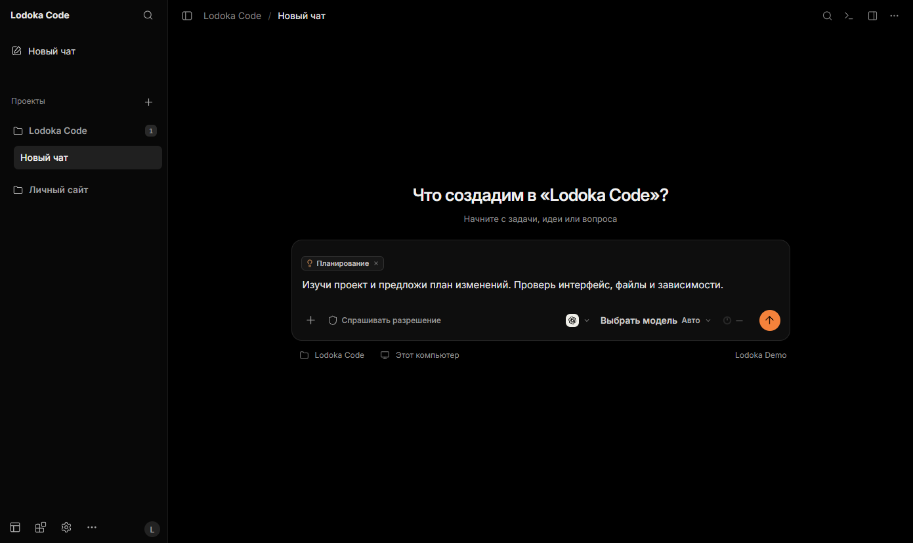
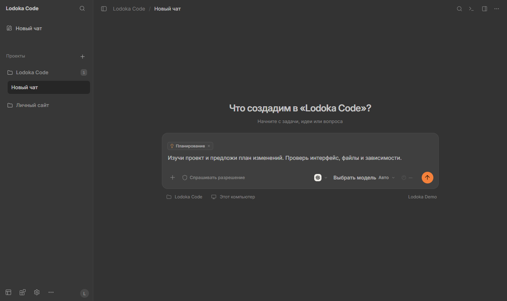
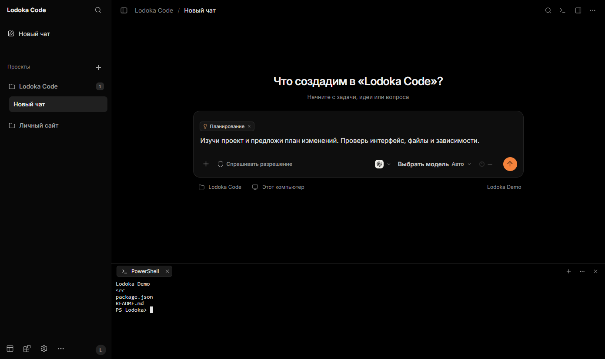
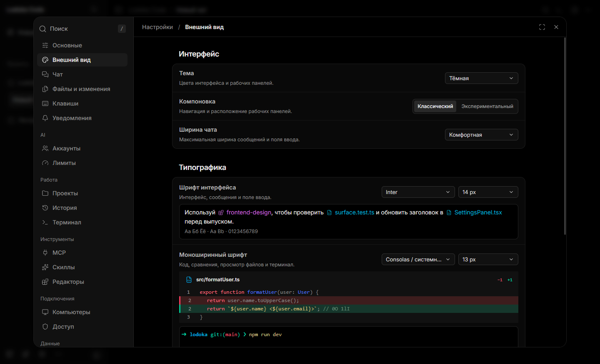

  

<h1 align="center">Lodoka Code</h1>

<strong>Проекты, ИИ и инструменты — в одном рабочем пространстве.</strong>

Codex · Claude Code · MCP и скиллы · Unity и Blender

<strong>Windows 11 x64</strong> &nbsp; / &nbsp; Preview 0.6.0 &nbsp; / &nbsp; Русский и English

  <a href="#возможности">Возможности</a> ·
  <a href="#установка">Установка</a> ·
  <a href="#что-нового-в-060">Что нового</a> ·
  <a href="#обновления">Обновления</a>

Lodoka Code объединяет AI-чаты, рабочие папки, файлы и терминал в настольном приложении. Опишите задачу, приложите примеры и следите за работой агента: от изучения проекта и плана до изменений и проверки результата.

Можно работать на этом компьютере или подключить его к собственному HTTPS-хабу, чтобы управлять задачами удалённо. Доступ к моделям предоставляют ваши аккаунты Codex и Claude Code.

## Возможности

- **Чаты и проекты.** Отдельные рабочие папки, история, память проекта, вложения и сохранённые черновики. Уточнения можно поставить в очередь, а в поддерживаемых сценариях — передать текущему агенту.
- **Файлы и изменения.** Просмотр кода, Markdown, изображений и Git diff в рабочей панели. Результаты доступны рядом с перепиской.
- **Терминал внутри приложения.** Вкладки PowerShell и CMD, история вывода и плавное открытие панели. Скрытие панели и закрытие терминала — отдельные действия.
- **MCP и скиллы.** Подключайте инструменты и инструкции под свою задачу. Доступность операций зависит от провайдера, разрешений и установленных компонентов.
- **Unity и Blender.** Работа с редакторами, моделями, материалами, экспортом и импортом через настроенные интеграции. Для них нужны сами редакторы и соответствующие подключения.
- **Настраиваемый интерфейс.** Светлая и тёмная темы, два варианта компоновки, настройки шрифтов, русский и английский языки.

## Как это выглядит

| Светлая тема | Встроенный терминал |
| :---: | :---: |
|  |  |

<strong>Внешний вид и типографика</strong>

Снимки сделаны в приложении 0.6.0 с отдельным демонстрационным проектом. Переписка и аккаунты пользователей не использовались; ответы модели для иллюстраций не генерировались.

## Установка

**Целевая платформа — Windows 11 x64.** Текущий установщик: `Lodoka-Code-0.6.0-Setup-x64.exe`. Установщик пока не опубликован. Публичная загрузка появится на [странице релизов](https://github.com/ligokit/Lodoka-Code/releases). Preview пока без цифровой подписи.

1. Запустите установщик и выберите папку приложения. Отдельно устанавливать Node.js для Lodoka Code не нужно.
2. В мастере выберите локальное пространство или укажите собственный HTTPS-хаб. Для локального пространства создайте владельца и пароль.
3. Подключите хотя бы один провайдер: **Codex** или **Claude Code**. Приложение поможет проверить официальные CLI; вход выполняется через браузер.
4. Создайте проект, выберите рабочую папку и начните чат. MCP, скиллы и редакторы можно настроить позже.

Закрытие окна оставляет приложение в трее. Для полного выхода используйте **«Выйти»**. Автозапуск включается отдельно.

Git понадобится для Git-операций и контрольных точек файлов. Unity, Blender и другие внешние инструменты устанавливаются отдельно.

## Что нового в 0.6.0

- Обновлены создание проектов, аккаунты, поиск, карточки MCP и скиллов; выровнены общие элементы, шрифты и иконки.
- Терминал получил анимацию панели, закрытие отдельных вкладок и просмотр сохранённого вывода без запуска новой оболочки.
- Добавлены контрольные точки и восстановление для поддерживаемых сценариев, сведения о составе сессии и визуальные комментарии к снимкам.
- Улучшен показ длинных чатов и больших результатов инструментов; проверены сетевые обрывы и восстановление соединения без повторной отправки отклонённого ввода.

Сборка прошла 286 автоматических тестов и отдельные проверки готового Windows-пакета, установки и переустановки. Это не означает проверку всех провайдеров, проектов и конфигураций: реальный вход Claude, macOS, нативный iOS и другие масштабы Windows требуют отдельной приёмки. Для Unity/Blender проверен сценарий с простым анимированным объектом, а не все виды моделей и анимаций.

## Обновления

Сейчас приложение обновляется **вручную новым установщиком**. Завершите задачи, полностью выйдите из Lodoka Code и установите новую версию. Удалять профиль перед обновлением не нужно; перед важным обновлением сохраните резервную копию данных.

**Автообновление — следующий отдельный этап.** Собственный канал Lodoka Code ещё не настроен. Обновление этого README или публикация файлов на странице проекта не обновляет установленное приложение автоматически.

## Вопросы

<strong>Нужны ли свои аккаунты и подписки?</strong>

Да, для работы с моделями нужен доступ хотя бы к одному провайдеру. Lodoka Code не включает подписки OpenAI или Anthropic и не отменяет их лимиты. Доступные модели и инструменты зависят от аккаунта и провайдера.

<strong>Где выполняются задачи и хранятся данные?</strong>

Задачи выполняет выбранный компьютер. При локальной работе используется локальное пространство; при подключении к своему хабу история пространства хранится на нём. Профили провайдеров остаются на выполняющем компьютере. Локальный и удалённый режимы не объединяют аккаунты и историю автоматически.

<strong>Можно ли пользоваться с телефона или на macOS?</strong>

С телефона можно открыть собственный HTTPS-хаб в браузере. На iPhone его можно добавить на экран «Домой»; задачи продолжит выполнять подключённый включённый компьютер. Локальный режим сам по себе не открывает доступ через интернет.

Настольные сборки macOS и нативное приложение iOS пока не заявлены как проверенные выпуски.

---

Lodoka Code — независимый проект на основе [Team Room Community](https://github.com/iintuziasty-web/team-room). Это не официальный клиент OpenAI или Anthropic. Публичная страница проекта: [ligokit/Lodoka-Code](https://github.com/ligokit/Lodoka-Code).

Сохранены исходная [лицензия MIT](LICENSE), © 2026 Team Room Contributors, и [уведомления сторонних компонентов](THIRD_PARTY_NOTICES.md).
